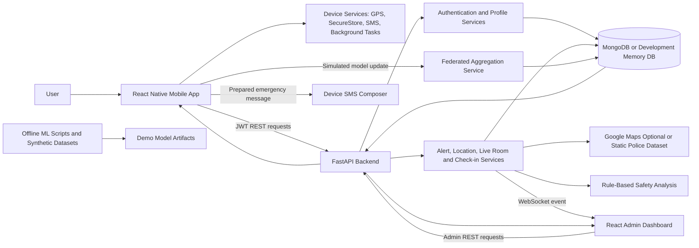

# 1. Project Title

**SafeHer: Manual SOS and Privacy-Preserving Safety Monitoring Prototype with Federated Learning Simulation**

## Evidence Classification

- **Confirmed:** Directly verified from the source code, configuration, datasets, tests, generated artifacts, or screenshots.
- **Prototype/Demo:** Implemented for demonstration, simulation, or fallback use and not validated as a production capability.
- **Not available:** Information or evidence is absent from the provided project files.

# 2. Abstract

SafeHer is a mobile-first personal safety prototype intended to reduce the delay involved in requesting help during a threatening situation. The current user-facing implementation focuses on a manual SOS workflow because a person under stress may not be able to make a call, type a detailed message, or separately share a location. The React Native mobile application allows an authenticated user to maintain a safety profile and trusted contacts, initiate an SOS with a 25-second cancellation window, capture a best-effort GPS location, create an emergency record, prepare an SMS message, and view alert history and tracking information. A FastAPI backend manages JWT authentication, profiles, contacts, alerts, locations, public live rooms, check-ins, evidence uploads, police-station lookup, and federated model update records. MongoDB is the intended database, with an in-memory database available for development demonstrations. A React and Vite admin dashboard displays alerts and federated metrics through REST APIs, polling, and WebSocket notifications. The repository also includes synthetic gesture data, offline machine-learning scripts, a rule-based gesture classifier, a separate safety-context model, and weighted federated averaging. Reproducible tests passed for the backend, ML helpers, and mobile logic. However, active gesture-triggered SOS, a bundled TensorFlow Lite model, automatic police notification, and production-ready SMS delivery are not completed in the current project. The expected outcome is a demonstrable end-to-end safety-alert platform that can be extended with validated on-device detection and real emergency-service integrations.

# 3. Problem Statement

## Existing Problem

During an emergency, a user may have limited time, mobility, privacy, or ability to unlock a phone, place a call, type a message, identify the current location, and contact several trusted people. Conventional manual communication can therefore delay the request for assistance.

## People Affected

The project is primarily presented as a women-safety application. Its workflow can also assist any mobile user who needs a rapid way to create and monitor an emergency alert.

## Limitations of Existing Approaches

- Emergency communication may require multiple separate actions.
- Location and contact details may not be included consistently.
- A false activation requires a clear cancellation mechanism.
- Centralized collection of raw gesture data can create privacy concerns.
- Trusted contacts and administrators may lack a shared, continuously updated alert view.

## Need for a New Solution

A unified mobile safety workflow is required to combine identity, trusted contacts, location capture, alert creation, message preparation, monitoring, and follow-up status in one system. Privacy-preserving model improvement is also desirable if gesture detection is introduced.

## Proposed Response

SafeHer provides a manual SOS button with a cancellation countdown, profile and contact management, GPS capture, backend alert storage, prepared SMS delivery through the phone's SMS application, police-station lookup, rule-based risk analysis, admin monitoring, live-room updates, and check-in support. The repository additionally demonstrates offline gesture modelling and federated averaging without uploading raw gesture traces. Gesture-triggered SOS is a project goal and prototype path, but it is not active in the current main mobile interface.

# 4. Project Objectives

## Main Objective

**Develop** a mobile-first emergency safety platform that rapidly creates location-aware SOS alerts, informs trusted contacts, and supports centralized monitoring while providing a foundation for privacy-preserving on-device intelligence.

## Specific Objectives

1. **Design** an accessible mobile workflow for authentication, safety-profile creation, trusted-contact management, and emergency activation.
2. **Implement** a manual SOS process with a 25-second false-alarm cancellation window.
3. **Integrate** best-effort GPS capture, map-link generation, background location updates, and static or Google Maps-based police lookup.
4. **Automate** the creation, storage, status tracking, and real-time display of emergency alert records.
5. **Secure** protected user and administrator operations through JWT authentication, role checks, hashed passwords, and mobile secure storage.
6. **Develop** trusted-circle live rooms, smart check-ins, alert history, contact-delivery tracking, and optional audio-evidence upload.
7. **Evaluate** gesture-classification and safety-context methods using the datasets and offline ML scripts supplied in the repository.
8. **Implement** a federated averaging prototype that accepts model updates and produces a weighted global model summary without receiving raw gesture samples.

# 5. Methodology

The following methodology is reconstructed from the implementation and project documentation.

## Step 1: Requirement Analysis

The project requirements were organized around rapid SOS activation, false-alarm cancellation, trusted contacts, location sharing, user and admin access, live monitoring, privacy, and prototype machine learning.

## Step 2: Data and Input Gathering

The system accepts user registration details, safety-profile data, trusted-contact details, GPS coordinates, alert metadata, check-in responses, device push tokens, optional audio files, and federated model weights. The ML folder contains a 300-row synthetic gesture-feature CSV and a separate 50-row safety-context CSV. No real-world gesture collection protocol or externally sourced dataset documentation is provided.

## Step 3: System Design

The system was divided into a React Native mobile client, FastAPI application server, MongoDB or development memory database, React admin dashboard, offline ML pipeline, and optional external services. REST APIs handle most operations, while a WebSocket broadcasts alert changes to the dashboard.

## Step 4: Technology Selection

React Native with Expo was selected for mobile development; FastAPI, Pydantic, Motor, and MongoDB for backend services; React and Vite for the admin interface; and Pandas, NumPy, scikit-learn, TensorFlow, and Joblib for offline ML work. Docker Compose defines a local multi-service stack.

## Step 5: Module Development

Separate modules were created for authentication, profiles, contacts, devices, alerts, notifications, locations, live rooms, check-ins, police lookup, risk analysis, evidence upload, federated aggregation, mobile safety services, and admin monitoring.

## Step 6: Algorithm and Model Implementation

The mobile code contains deterministic distress rules based on gesture duration, speed, distance, and direction changes. Offline scripts implement nearest-centroid modelling, Random Forest training, a neural-network/TFLite export path, TF-IDF with logistic regression for context severity, Haversine-distance police ranking, rule-based safety risk scoring, and weighted federated averaging.

## Step 7: System Integration

The mobile and admin clients communicate with the FastAPI backend through Axios. JWTs protect user routes and admin role checks protect administrative and aggregation routes. Alerts are stored in the database and broadcast through WebSocket. The mobile application can open the device SMS composer, while the backend can simulate or optionally use configured notification providers in the legacy alert path.

## Step 8: Testing and Validation

Pytest is used for backend and ML tests, while Vitest is used for mobile and admin tests. The project also includes a real-device safety test checklist, but completed observations are not present. The supplied dashboard screenshots visually confirm admin login and dashboard pages.

## Step 9: Performance Evaluation

The gesture demo metrics report 1.0000 accuracy on 300 synthetic samples, which is not evidence of real-world performance. The safety-context model reports 0.2667 accuracy on a 15-record test split. No response-time, GPS latency, SMS latency, battery-consumption, federated scalability, or production load results are available.

## Step 10: Deployment or Execution

The project can be executed locally with separate PowerShell scripts or Docker Compose. MongoDB, backend, and admin services are defined in Docker Compose. Expo or a native Android build is used for the mobile client. Production deployment guidance is documented, but evidence of an actual production deployment is not available.

# 6. System Architecture

## Major Components

1. **User:** Operates the Android/iOS-targeted SafeHer mobile application.
2. **Mobile User Interface:** Provides login, profile, contacts, manual SOS, countdown cancellation, SMS handoff, alert history, tracking, and federated-demo controls.
3. **Mobile Device Services:** Use SecureStore, GPS, background tasks, battery state, notifications, SMS composer, and optional audio recording.
4. **FastAPI Backend:** Validates requests and coordinates authentication, profiles, contacts, alerts, locations, live rooms, check-ins, police lookup, risk scoring, evidence upload, and federated records.
5. **Database:** MongoDB is the intended persistent store. An in-memory database with seeded demo accounts and contacts is available for development.
6. **Police and Map Processing:** Uses Google Maps APIs only when enabled and configured; otherwise it uses map URLs and a local JSON file containing eight Bengaluru police stations ranked by Haversine distance.
7. **Notification Processing:** The current manual SOS flow prepares contact messages and relies on the mobile SMS composer. Twilio, Expo push, and Firebase code exists, but provider use depends on configuration and differs between alert paths.
8. **Admin Dashboard:** Authenticates an administrator and retrieves alerts and federated metrics through REST, polling, and WebSocket refresh events.
9. **Offline ML and Federated Prototype:** Generates or reads datasets, trains demo models, performs context inference, accepts simulated model updates, and computes weighted global averages.
10. **Output Layer:** Produces stored alerts, map links, prepared messages, contact-delivery states, risk summaries, live-room pages, dashboard views, model summaries, and optional audio-evidence URLs.

## Data Flow

The user authenticates through the mobile client and stores the returned tokens in Expo SecureStore. Profile and contact data are sent to FastAPI and stored in MongoDB or the development memory database. When the user presses SOS, the mobile app validates the profile, runs a 25-second countdown, captures a location, and sends an alert payload to the backend. The backend enriches the alert with an address when Google Maps is enabled, ranks nearby police stations, creates contact and police message previews, calculates a rule-based risk summary, stores the record, and broadcasts an alert event. The mobile app can then open the device SMS composer and update the delivery state. The admin dashboard retrieves the alert and refreshes after polling or a WebSocket event. Separately, offline ML scripts produce model artifacts, while authenticated clients can submit or simulate model-weight updates for server-side weighted aggregation.

# 7. System Architecture Diagram

# 8. Modules of the System

| Module | Purpose | Input | Processing | Output |
| --- | --- | --- | --- | --- |
| Authentication | Register and authenticate users and administrators | Name, email, password, phone, refresh token | Hashes passwords, verifies credentials, creates access/refresh JWTs, checks admin role | Tokens and authenticated user profile |
| Safety Profile | Maintain information required before manual SOS | Name, age, phone, locality, city, trusted contacts | Validates and updates user data; replaces stored trusted contacts | Saved safety profile |
| Trusted Contacts | Manage emergency recipients | Contact name, phone, relationship | Validates, stores, lists, and deletes SMS contacts | Contact records |
| Manual SOS | Create the primary emergency event | Completed profile, button press, countdown result, GPS | Validates readiness, permits cancellation, captures location, submits emergency alert | Stored SOS alert and result modal |
| Legacy Gesture Processing | Prototype gesture feature and rule path | Touch coordinates and timestamps | Extracts duration, speed, distance, and direction changes; applies deterministic rules | Gesture label, confidence, emergency flag |
| Location and Tracking | Capture and update location | Foreground/background GPS readings | Uses current, last-known, cached, or unavailable fallback; posts location updates | Coordinates, accuracy, map link, live-room timeline updates |
| Police Lookup and Maps | Identify nearby police information | Latitude and longitude | Uses Google Maps when configured; otherwise calculates Haversine distance to local station data | Nearest station and top-three station list |
| Safety Analysis | Produce a risk-oriented alert summary | Alert status, coordinates, contacts, map and police context | Applies deterministic scoring and action rules | Risk level, priority score, reasoning, recommended actions |
| Contact Delivery | Prepare and track emergency messages | Trusted contacts and alert message | Creates per-contact prepared records; mobile opens SMS composer and marks results | Delivery status and per-contact delivery records |
| Notification and Device | Support optional remote notifications | Device token, alert data, provider credentials | Registers devices; sends Expo/Firebase or simulated notifications in supported paths | Provider delivery result |
| Live Room | Share ongoing emergency context | Alert, contacts, subsequent locations and notes | Creates a public tokenized room, timeline, acknowledgements, and location freshness | Public live-room page and JSON status |
| Smart Check-in | Request and monitor safety confirmation | Reason, due time, acknowledgement | Stores pending check-in, marks overdue records missed, supports background escalation | Pending, safe, need-help, or missed status |
| Alert Evidence | Attach optional audio evidence | Alert identifier and uploaded audio file | Stores file under backend evidence storage and records metadata | Public evidence URL and metadata |
| Admin Dashboard | Monitor alerts and prototype model metrics | Admin credentials, REST data, WebSocket events | Polls alerts and model data, renders metrics, triggers demo data, resolves alerts | Operational dashboard |
| Federated Learning | Demonstrate privacy-preserving aggregation | User ID, round, sample count, weights, metrics | Validates ownership and calculates sample-weighted averages | Global model weight and metric summary |
| Offline ML | Prepare datasets and train prototype models | Gesture CSV or context CSV | Runs nearest centroid, Random Forest, neural network/TFLite, or TF-IDF logistic regression scripts | JSON, Joblib, Keras, TFLite, labels, and metrics when generated |
| Theme and Settings | Control UI theme and stored preferences | System/light/dark mode and safety settings | Persists preferences in SecureStore | Themed interface and safety configuration |

# 9. Technologies Used

| Technology/Tool | Purpose in the Project |
| --- | --- |
| TypeScript | Mobile and admin application development |
| Python 3.10+ | Backend services, tests, and ML scripts |
| React Native 0.81.5 | Cross-platform mobile user interface |
| Expo 54 | Mobile development, device APIs, and build workflow |
| React 19 | Component framework for mobile and admin interfaces |
| React Navigation | Mobile stack and bottom-tab navigation |
| FastAPI | REST API and WebSocket backend |
| Uvicorn | ASGI server for FastAPI |
| Pydantic and Pydantic Settings | Request validation and environment configuration |
| MongoDB 7 | Intended persistent database |
| Motor and PyMongo | Asynchronous and standard MongoDB access |
| In-memory database implementation | Development and prototype execution without MongoDB |
| JWT with python-jose | Access and refresh token generation and validation |
| Passlib PBKDF2-SHA256 | Password hashing |
| Axios | HTTP communication from mobile and admin clients |
| WebSocket | Real-time alert-change notification to the admin dashboard |
| Vite | Admin dashboard development and production build |
| Expo SecureStore | Mobile token, preference, and cached-state storage |
| Expo Location and Task Manager | Foreground/background GPS capture |
| Expo SMS | Opens the device SMS composer for trusted contacts |
| Expo Notifications and Firebase Admin | Optional push registration and notification support |
| Twilio SDK | Optional SMS/WhatsApp delivery in the legacy notification service |
| Google Maps Web APIs | Optional reverse geocoding and nearby police lookup |
| Local police-station JSON dataset | Fallback Bengaluru police lookup |
| Pandas and NumPy | Dataset processing and numerical operations |
| scikit-learn | Random Forest and TF-IDF/logistic-regression models |
| TensorFlow and TensorFlow Lite | Defined neural-network training and mobile export pipeline |
| Joblib | Serialization of scikit-learn models |
| Vitest and Testing Library | Mobile logic and admin component tests |
| Pytest and pytest-asyncio | Backend and ML tests |
| Docker and Docker Compose | Local MongoDB, backend, seed, and admin stack |
| Android Gradle tooling | Native Android application build |
| PowerShell | Local prototype, native device, Wi-Fi, and tunnel launch scripts |

# 10. Results

## Final Output

The project produces a working prototype composed of a mobile application, FastAPI backend, database layer, admin dashboard, offline ML scripts, demo model artifacts, and local execution scripts.

## Successfully Implemented Features

- User signup, login, refresh-token handling, secure mobile token persistence, and admin role checks.
- Safety-profile and trusted-contact management.
- Manual SOS with a 25-second cancellation window.
- GPS capture with current, last-known, cached, and unavailable fallback states.
- Alert storage, history, status changes, false-alarm records, map links, and WebSocket broadcasts.
- Prepared emergency messages, device SMS-composer handoff, and contact-delivery status tracking.
- Optional Google Maps enrichment and fallback ranking of eight local police stations.
- Rule-based safety risk analysis and recommended actions.
- Public trusted-circle live rooms, acknowledgements, notes, location updates, and smart check-ins.
- Background location, battery fallback, optional push registration, fake-call audio helpers, and optional alert-audio upload services.
- Admin login, alert monitoring, demo alert creation, model seeding, and alert resolution.
- Federated update storage and sample-weighted aggregation.
- Offline gesture and safety-context training scripts.

## Reproducible Validation Results

- Backend: **16 tests passed**.
- ML helpers: **2 tests passed**.
- Mobile: **13 tests passed**.
- Mobile TypeScript check: **passed** with `npx tsc --noEmit`.
- Admin production build: **passed**.
- Admin tests: **failed to start** because the provided `node_modules` tree is missing an `lru-cache` module required by a CSS dependency. The current dashboard test mocks are also inconsistent with the dashboard's `/alerts` request, so the documented earlier result of two passing tests is not reproducible from the current files.
- A pytest-asyncio deprecation warning is present because the default fixture loop scope is not explicitly configured.

## Model and Dataset Results

- `gesture_features.csv`: 300 synthetic records, containing 160 `normal_interaction` and 140 `distress_swipe` rows.
- Gesture demo artifact: 1.0000 accuracy and 0.9634 average confidence on the same synthetic 300-record dataset. This must not be interpreted as real-world accuracy.
- `women_safety_dataset_v2.csv`: 50 records with 13 Critical, 24 High, and 13 Medium labels.
- Safety-context model: 0.2667 test accuracy on 15 records. It is not integrated into the backend or mobile alert decision.
- Federated demo metrics are generated from seeded or simulated client weights; they are demonstration values rather than results from real on-device training.
- Real-world model accuracy: **Not available in the provided project files**.
- Precision, recall, false-positive rate, and false-negative rate for deployed gesture detection: **Not available in the provided project files**.

## Screens and Generated Materials

- Three valid admin screenshots show the login page and dashboard layouts with alert controls, alert counters, and model metrics.
- `emulator-screen.png` is not a valid standard PNG byte stream in the provided files and could not be rendered.
- Multiple Expo QR images are provided for previous local network and tunnel sessions.
- Seven `.m4a` evidence files are present, but their source scenarios, durations, and validation results are **not available in the provided project files**.

## Benefits

- Consolidates profile, contacts, location, alert creation, message preparation, and monitoring.
- Provides a clear false-alarm cancellation period.
- Supports local/demo execution with either MongoDB or an in-memory store.
- Keeps raw gesture samples outside the federated update API.
- Provides fallback operation when Google Maps or notification credentials are absent.

## Errors, Incomplete Modules, and Limitations

1. The main mobile UI explicitly states that only manual SOS is active; no screen currently connects `useGestureRecorder` to the user-facing SOS workflow.
2. `gesture_model.tflite`, the Keras model, Random Forest artifact, and neural-network metrics are absent. Android autolinking for `react-native-fast-tflite` is disabled.
3. The gesture CSV/model contains two classes and 300 rows, while the current dataset-generation script defines four classes and 540 rows, showing artifact and pipeline inconsistency.
4. Mobile and ML gesture label files use different label orders, which could invert predictions if an exported model and labels are not synchronized.
5. The manual SOS backend marks alerts `SENT_TO_POLICE`, but it only generates and stores a police-message preview; it does not contact a police system.
6. The manual SOS backend prepares contact messages but does not automatically send them. The user must complete sending through the phone's SMS application unless another alert path and provider configuration are used.
7. The configured `OPENAI_API_KEY` is unused; the “AI Safety Agent” is a deterministic rule-based scorer, not an OpenAI-powered agent.
8. The safety-context model is disconnected from mobile and backend decisions and has low measured accuracy.
9. The README references a GitHub Actions workflow, but `.github/workflows/ci.yml` is absent.
10. Demo secrets, demo credentials, cleartext Android traffic, admin token storage in browser local storage, public evidence files, an unauthenticated alert WebSocket, and debug signing for release builds require security hardening.
11. No completed real-device test notes, usability study, production deployment proof, provider delivery proof, or emergency-service integration evidence is supplied.

# 11. Conclusion

SafeHer demonstrates a substantial end-to-end personal safety prototype. Its strongest confirmed capability is the manual SOS workflow that combines a safety profile, trusted contacts, a cancellation countdown, location capture, alert enrichment, message preparation, database storage, and admin monitoring. The backend is modular and includes useful extensions such as public live rooms, smart check-ins, evidence upload, police lookup, and federated update aggregation. The backend, ML helper, and mobile logic tests are reproducible, and the admin application builds successfully.

The project does not yet fully achieve the title described in its original README because active gesture-triggered threat detection and deployed federated learning are not connected to the current mobile emergency flow. The available ML results are based on small synthetic datasets, the TensorFlow Lite artifact is missing, and real police or automatic contact delivery is not demonstrated. Therefore, the project should be presented as a functional manual SOS and monitoring prototype with offline and simulated privacy-preserving ML components, rather than as a production-ready autonomous threat-detection system.

# 12. Future Enhancements

1. **Integrate** a visible and accessible gesture-capture interface with the countdown-based SOS workflow while retaining manual activation.
2. **Collect** a consented, diverse, real-world gesture dataset and evaluate false positives, false negatives, latency, and robustness across devices.
3. **Generate** and bundle a synchronized TensorFlow Lite model and label manifest, then enable and test native Android inference.
4. **Replace** simulated federated updates with genuine on-device local training, secure aggregation, update validation, versioning, and rollback.
5. **Integrate** verified SMS, WhatsApp, push, and emergency-response providers with delivery receipts and explicit escalation policies.
6. **Improve** security by replacing demo secrets, authenticating WebSockets, protecting evidence access, encrypting sensitive contact data, using production signing, and moving admin sessions away from long-lived local storage.
7. **Unify** the manual and legacy alert models so status names, notification behavior, map fields, and live-room creation remain consistent.
8. **Add** complete real-device, accessibility, battery, offline-network, load, and end-to-end tests, and restore a working continuous-integration workflow.
